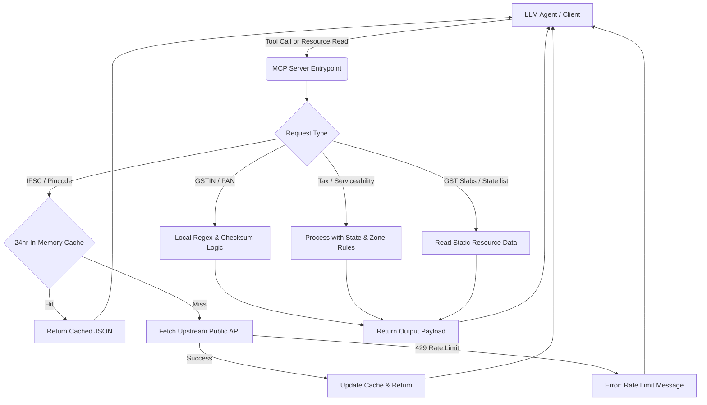
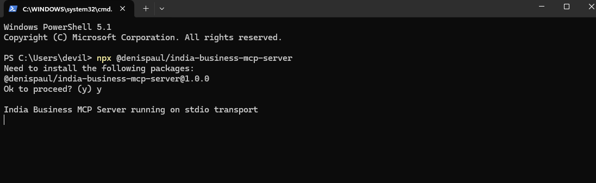
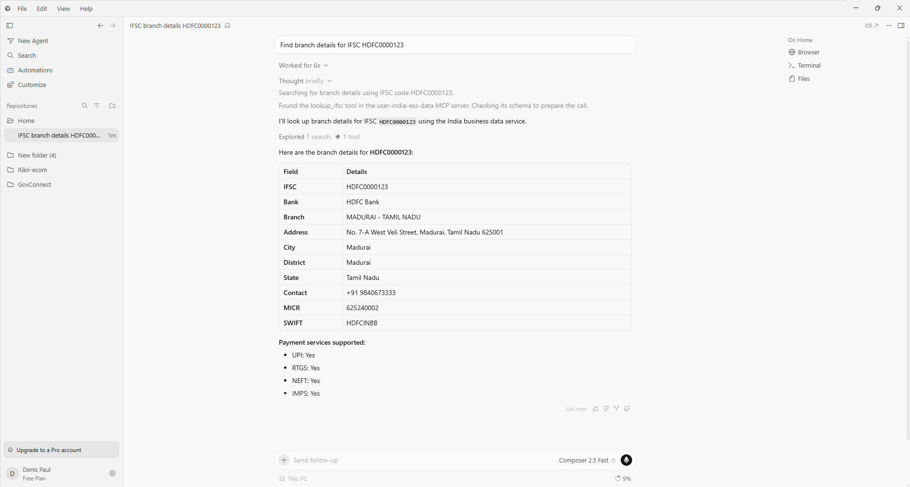

# Indian Contractor Compliance & Onboarding MCP Server 🇮🇳

[](https://github.com/denispaul2406/india-business-mcp-server/actions/workflows/ci.yml)
[](https://smithery.ai/server/@denispaul/india-business-mcp-server)

An open-source Model Context Protocol (MCP) server designed to streamline tax withholding (TDS), verification, and invoicing compliance when hiring and paying Indian freelance developers and independent contractors. Exposes public data APIs, local tax-compliance rules, and validation tools directly to LLM agents (like Claude Desktop or Cursor).

This server enables LLM clients to verify contractor identities, cross-reference GSTIN and PAN alignment, compute tax withholding (TDS) percentages (e.g., Section 194J vs. 194C), validate banking details (IFSC), and verify delivery zone serviceability.

## 🏗️ Architecture Flow



---

## Why I Built This

Every company hiring remote Indian software developers or onboarding independent contractors spends hours validating their tax identifiers (PAN, GSTIN), verifying payout destination branch details (IFSC), and calculating withholding tax (TDS) brackets (e.g. Section 194J vs 194C). Because these systems are usually verified manually, LLM agents running contractor onboarding pipelines couldn't inspect or cross-reference these rules mid-workflow.

This server bridges that gap by grouping tax compliance rules, bank lookups, and offline structural validators into a single plug-and-play local server, allowing AI agents to fully handle freelancer onboarding verification.

---

## ⚠️ Disclaimer & Scope

This server performs **structural validation** (e.g., verifying a GSTIN's Mod-36 checksum, checking PAN pattern syntax, and checking PAN-GSTIN matching logic). It does **not** query official databases (like NSDL or the GST portal) to verify if the identifiers are active or registered to a real entity. This is an auxiliary utility for onboarding, forms, routing, and autocomplete, not a replacement for official, paid KYC/verification APIs.

---

## Tools

This server implements **Tools** (executable actions) from the Model Context Protocol specification. This allows LLM agents to perform validation checks, local compliance calculations, and branch lookups.

#### 1. `lookup_ifsc`
* **Description**: Queries bank, branch, address, contact, and supported payment features (UPI, IMPS, NEFT, RTGS) from an 11-digit IFSC code.
* **Upstream API**: Razorpay's public IFSC API (`https://ifsc.razorpay.com/`) - free, no key.
* **Features**: Automated local regex checking and a 24-hour local TTL cache.

#### 2. `lookup_pincode`
* **Description**: Resolves a 6-digit Indian PIN code to a list of post offices, divisions, districts, states, and circles.
* **Upstream API**: India Post's public API (`https://api.postalpincode.in/`) - free, no key.
* **Features**: Automated local formatting validation and a 24-hour local TTL cache.

#### 3. `validate_gstin`
* **Description**: Verifies a 15-digit GSTIN (Goods and Services Tax Identification Number) locally.
* **Features**:
  * Full structural regex check.
  * Offline Mod-36 weighted sum checksum validation.
  * Extracts registered Indian State/UT name, PAN, and Taxpayer/Entity Type (e.g. Individual, Company, Firm, LLP, Trust).

#### 4. `validate_pan`
* **Description**: Validates format and structure of a 10-character Permanent Account Number (PAN) card locally.
* **Features**:
  * Full structural regex check.
  * Extracts the legal entity type of the holder (Individual, HUF, Firm, LLP, Company, Government, Trust, etc.).

#### 5. `check_pincode_serviceability`
* **Description**: Custom utility to check if a PIN code belongs to specific allowed states or districts. Useful for managing serviceable checkout/delivery zones in e-commerce workflows.

#### 6. `calculate_gst_tax`
* **Description**: Computes GST tax breakdowns (CGST, SGST, IGST) automatically.
  * Validates the seller's GSTIN and matches the seller's registration state against the buyer's state.
  * Handles exclusive and inclusive tax calculations.
  * Routes taxes to CGST+SGST (if intra-state) or IGST (if inter-state).

#### 7. `verify_freelance_contractor`
* **Description**: Evaluates an Indian freelancer or contractor for onboarding and tax compliance (TDS withholding brackets under Section 194J/194C, PAN-GSTIN matching, entity classification).
* **Features**:
  * Offline-first validation and verification.
  * Cross-checks if the PAN embedded inside the GSTIN matches the standalone PAN.
  * Classifies Holder Type (Individual vs Corporate entity) based on the 4th letter of the PAN.
  * Computes appropriate TDS withholding rate brackets (e.g. 2% for Technical Services under Section 194J, 1% for Individual Contractors under 194C, 2% for Corporate Contractors under 194C, and a 20% penalty withholding alert under Section 206AA if PAN is invalid).
  * Returns actionable warnings and recommendations for compliance and banking audits.

#### 8. `bulk_validate_gstins`
* **Description**: Validates a batch of GSTIN codes in a single request (maximum 50 items). Returns verification status, state registrations, and taxpayer types.

#### 9. `bulk_validate_pans`
* **Description**: Validates a batch of PAN card numbers in a single request (maximum 50 items). Returns validation status and entity classifications.

#### 10. `bulk_lookup_ifsc`
* **Description**: Performs batch bank branch lookups for a list of IFSC codes in a single call (maximum 50 items). Optimizes speed by retrieving details from the 24-hour cache where available.

## Resources

MCP Resources are read-only documents that LLM agents can pull to gain domain context on Indian business rules.

#### 1. `india-business://gst-slabs`
* **Name**: Indian GST Rate Slabs Reference
* **MimeType**: `text/markdown`
* **Content**: The official GST rate slabs in India (0%, 5%, 12%, 18%, 28%) and which goods/services they apply to.

#### 2. `india-business://state-codes`
* **Name**: GST State Codes Reference
* **MimeType**: `text/markdown`
* **Content**: Complete mapping of 2-digit GST state codes (e.g. `27` -> Maharashtra, `29` -> Karnataka) for cross-referencing state codes.

## Demo & Examples (Proof it Works)

Here is how the tools respond directly in an LLM client:

### 📸 Live Demo in Cursor


*Active configuration showing connected status in Cursor Settings*


*Real-time tool execution in Cursor Chat returning Indian business data lookup results*

### ⚡ End-to-End Agent Scenario: Processing a Payout Refund

Instead of calling tools in isolation, an LLM agent (like Claude or Cursor) can chain these tools together to resolve a complete checkout business task.

**User Prompt**:
> *"Process a customer refund payout of ₹11,800 (GST inclusive, rate 18%) for a buyer located in Karnataka (pincode `560001`). Verify their pincode is serviceable under our 'Karnataka' delivery rules. Our company's seller GSTIN is `27AAPFU0939F1ZV` (registered in Maharashtra). If serviceable, calculate the CGST/SGST/IGST tax routing breakdown and lookup the bank branch details for their beneficiary IFSC code `HDFC0000123` so we can queue the payout transfer."*

**How the Agent Solves It (Multi-Turn Tool Chaining)**:

1. **Serviceability Check**:
   The Agent calls `check_pincode_serviceability(pincode: "560001", allowedStates: ["Karnataka"])`.
   * *Output*: Pincode `560001` belongs to Bangalore, Karnataka. Status: **Serviceable**.

2. **GST Routing & Calculations**:
   The Agent calls `calculate_gst_tax(amount: 11800, rate: 18, sellerGstin: "27AAPFU0939F1ZV", buyerStateCodeOrName: "Karnataka", inclusive: true)`.
   * *Output*: The seller is registered in Maharashtra (`27`) and the buyer is in Karnataka (`29`). Because these are different states, it routes the entire tax as **IGST (₹1,800)** on a base amount of **₹10,000**.

3. **Bank Transfer Destination Verification**:
   The Agent calls `lookup_ifsc(ifsc: "HDFC0000123")`.
   * *Output*: IFSC code resolves to **HDFC Bank, Madurai West Veli Street branch** (Tamil Nadu).

**Final Agent Response**:
> "Refund payout verified and calculated successfully:
> 1. **Logistics**: Pincode `560001` is confirmed **serviceable** inside Karnataka.
> 2. **Tax Routing**: Out-of-state transaction (Maharashtra to Karnataka), requiring **IGST (18%) routing**. Base amount is **₹10,000.00** and routed IGST is **₹1,800.00** (total invoice payout: ₹11,800.00).
> 3. **Settlement**: Beneficiary bank branch is **HDFC Bank, Madurai branch**, West Veli Street. UPI, IMPS, NEFT, and RTGS are supported.
> 
> Transfer is ready to be queued for payout."

### Example 1: Resolving IFSC branch details
**Prompt**: *"What is the branch address and state for IFSC `HDFC0000123`?"*

**Claude Tool Call**:
```json
{
  "name": "lookup_ifsc",
  "arguments": {
    "ifsc": "HDFC0000123"
  }
}
```

**Response**:
```json
{
  "isValid": true,
  "data": {
    "ifsc": "HDFC0000123",
    "bank": "HDFC Bank",
    "branch": "MADURAI - TAMIL NADU",
    "address": "NO. 7-A WEST VELI STREETMADURAITAMILNADU625 001",
    "city": "MADURAI",
    "district": "MADURAI",
    "state": "TAMIL NADU",
    "contact": "+919840673333",
    "upi": true,
    "rtgs": true,
    "neft": true,
    "imps": true
  }
}
```

### Example 2: Calculating Tax Breakdown
**Prompt**: *"Calculate 18% GST tax breakdown for a ₹10,000 service sold by a seller with GSTIN `27AAPFU0939F1ZV` to a buyer in Karnataka."*

**Claude Tool Call**:
```json
{
  "name": "calculate_gst_tax",
  "arguments": {
    "amount": 10000,
    "rate": 18,
    "sellerGstin": "27AAPFU0939F1ZV",
    "buyerStateCodeOrName": "Karnataka"
  }
}
```

**Response**:
```json
{
  "isValid": true,
  "sellerState": "Maharashtra",
  "buyerState": "Karnataka",
  "isInterState": true,
  "breakdown": {
    "baseAmount": 10000,
    "cgstRate": 0,
    "cgstAmount": 0,
    "sgstRate": 0,
    "sgstAmount": 0,
    "igstRate": 18,
    "igstAmount": 1800,
    "totalGstRate": 18,
    "totalGstAmount": 1800,
    "totalAmount": 11800
  }
}
```

### Example 3: Onboarding Contractor Verification
**Prompt**: *"Run onboarding compliance check for a contractor with PAN `AAPPU0939F` and GSTIN `27AAPPU0939F1ZA`."*

**Claude Tool Call**:
```json
{
  "name": "verify_freelance_contractor",
  "arguments": {
    "pan": "AAPPU0939F",
    "gstin": "27AAPPU0939F1ZA"
  }
}
```

**Response**:
```json
{
  "panValid": true,
  "gstinValid": true,
  "gstinProvided": true,
  "entityType": "P",
  "entityTypeName": "Individual (Proprietorship)",
  "isIndividualFreelancer": true,
  "panGstinMatch": true,
  "tdsWithholdingSection": "Section 194J (Technical Services) / Section 194C (Contractor)",
  "tdsStandardRatePercent": "2% (Technical Services/Software) or 1% (General Contract)",
  "tdsRateAppliedPercent": 2,
  "complianceStatus": "MATCHED",
  "warnings": [],
  "recommendations": [
    "For software development or coding consulting, deduct 2% TDS under Section 194J.",
    "For general outsourcing contracts (non-technical), deduct 1% TDS under Section 194C.",
    "The contractor has a valid GSTIN. Verify that their invoices charge the standard 18% GST for services and display their GSTIN."
  ]
}
```

---

## Setup & Configuration

### Prerequisites
* **Node.js** (v18.0.0 or higher recommended for native fetch support).
* **npm** (comes with Node.js).

### Option A: Quick Run (via NPM Registry)
Available on npm — run directly via `npx`:

```json
{
  "mcpServers": {
    "india-business-data": {
      "command": "npx",
      "args": [
        "-y",
        "@denispaul/india-business-mcp-server"
      ]
    }
  }
}
```

### Option B: Local Source Installation & Build

1. Clone the project to your chosen workspace directory:
   ```bash
   git clone https://github.com/denispaul2406/india-business-mcp-server.git
   cd india-business-mcp-server
   ```
2. Install dependencies:
   ```bash
   npm install
   ```
3. Compile the TypeScript codebase:
   ```bash
   npm run build
   ```

---

## Integration Guides

### 1. Claude Desktop App
To connect the server to Claude Desktop, edit your `claude_desktop_config.json` file.

* **Windows Path**: `%appdata%\Claude\claude_desktop_config.json`
* **macOS/Linux Path**: `~/Library/Application Support/Claude/claude_desktop_config.json`

Add the server using your local build path:

```json
{
  "mcpServers": {
    "india-business-data": {
      "command": "node",
      "args": [
        "build/index.js"
      ]
    }
  }
}
```
*(Note: Because Claude Desktop runs globally, you must replace `"build/index.js"` with the absolute path to this folder on your machine, e.g. `"C:/Users/username/Desktop/mcp-server/build/index.js"`).*

Restart Claude Desktop, and you will see the tool icon appear in the chat prompt.

### 2. Cursor IDE
To connect the server to Cursor:
1. Open Cursor Settings -> **Features** -> **MCP**.
2. Click **+ Add New MCP Server**.
3. Configure as:
   - **Name**: `india-business-data`
   - **Type**: `stdio`
   - **Command**: `node build/index.js` *(Note: Replace with the absolute path on your machine, e.g. `node C:/Users/username/Desktop/mcp-server/build/index.js`)*
4. Save and look for the green status light indicating it's active.

---

## Local Verification & Development

You can dry-run the core logic and cache verification using our prebuilt test script:
```bash
node build/test.js
```

---

## License
MIT License. Feel free to copy, modify, and build upon this for your projects!

---

## 👤 Author & Connect
* **GitHub**: [github.com/denispaul2406](https://github.com/denispaul2406)
* **LinkedIn**: [linkedin.com/in/DenisPaul](https://linkedin.com/in/denis-paul-11b70932b)

